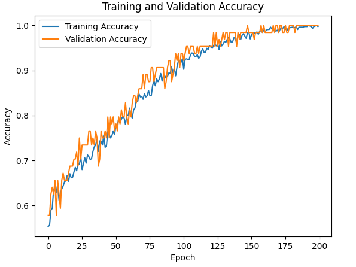
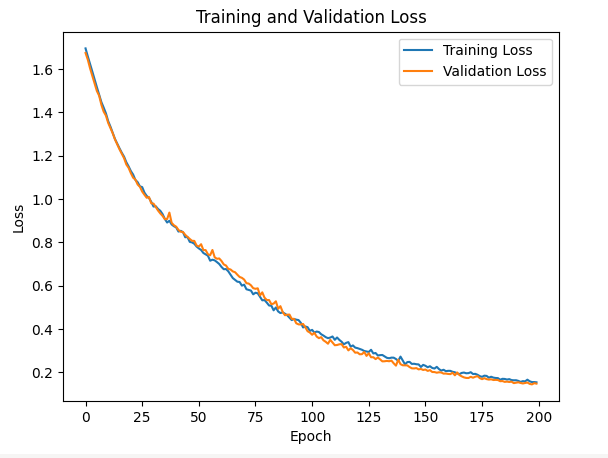
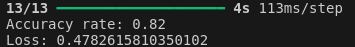
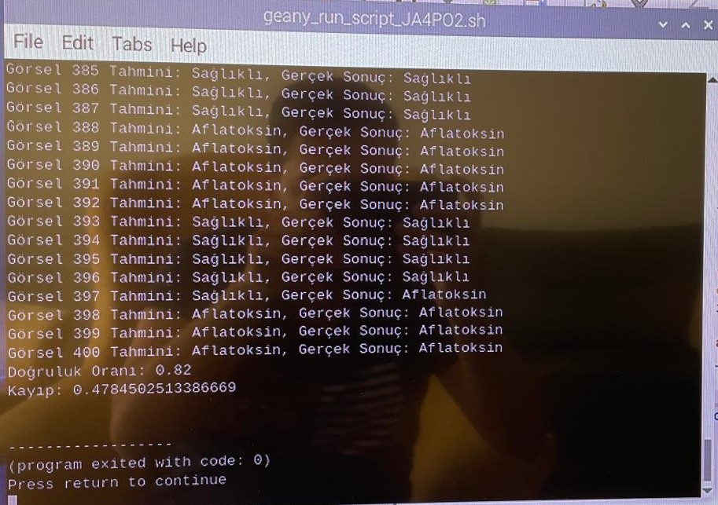
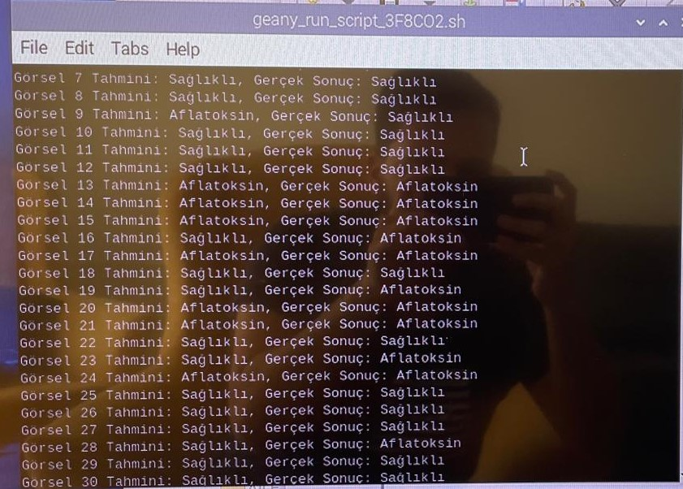

# Archived experiment results

These are the original results embedded in the 2024 report and presentations. Figures and workbook files are extracted byte-for-byte. The CSV and table below transcribe the existing result table. No model was retrained and no new prediction results were generated.

## Selected model learning curves

Attempt-8 is the model selected in the report. Its accuracy plot appears as Figures 32 and 34, and its loss plot as Figures 33 and 35. Repeated figure references use the same original image bytes.

## All learning curves

| Attempt | Accuracy curve | Loss curve |
| --- | --- | --- |
| 1 | [Training and validation accuracy](learning_curves/attempt_01_accuracy.png) | [Training and validation loss](learning_curves/attempt_01_loss.png) |
| 2 | [Training and validation accuracy](learning_curves/attempt_02_accuracy.png) | [Training and validation loss](learning_curves/attempt_02_loss.png) |
| 3 | [Training and validation accuracy](learning_curves/attempt_03_accuracy.png) | [Training and validation loss](learning_curves/attempt_03_loss.png) |
| 4 | [Training and validation accuracy](learning_curves/attempt_04_accuracy.png) | [Training and validation loss](learning_curves/attempt_04_loss.png) |
| 5 | [Training and validation accuracy](learning_curves/attempt_05_accuracy.jpeg) | [Training and validation loss](learning_curves/attempt_05_loss.jpeg) |
| 6 | [Training and validation accuracy](learning_curves/attempt_06_accuracy.png) | [Training and validation loss](learning_curves/attempt_06_loss.png) |
| 7 | [Training and validation accuracy](learning_curves/attempt_07_accuracy.png) | [Training and validation loss](learning_curves/attempt_07_loss.png) |
| 8 | [Training and validation accuracy](learning_curves/attempt_08_accuracy.png) | [Training and validation loss](learning_curves/attempt_08_loss.png) |

The original per-epoch numerical histories were not supplied. The archived curves are source images, not reconstructed epoch values.

## Results of all attempts

Training accuracy, training loss and test accuracy come from the original embedded Table 3. Test loss comes from the accompanying report paragraphs. Percent signs on losses are retained literally from the source and should not be interpreted as a newly validated unit conversion.

| Attempt | Training accuracy (source) | Training loss (source) | Test accuracy (source) | Test loss (narrative source) |
| --- | ---: | ---: | ---: | ---: |
| Attempt-1 | %92.71 | %0.2518 | %80.75 | %0.42 |
| Attempt-2 | %94.79 | %0.1807 | %85.00 | %0.37 |
| Attempt-3 | %93.23 | %0.2362 | %79.00 | %0.50 |
| Attempt-4 | %98.70 | %0.1169 | %84.00 | %0.53 |
| Attempt-5 | %98.65 | %0.1151 | %85.55 | %0.35 |
| Attempt-6 | %92.19 | %0.2913 | %79.75 | %0.40 |
| Attempt-7 | %97.40 | %0.1248 | %81.75 | %0.53 |
| Attempt-8 | %97.79 | %0.2005 | %82.00 | %0.48 |
| Attempt-9 | %97.79 | %0.2005 | %92.75 | %0.37 |
| Attempt-10 | %97.79 | %0.2005 | %39.75 | %0.89 |
| Attempt-11 | %97.79 | %0.2005 | %50.00 | %0.78 |

- [Machine-readable CSV transcription](tables/all_attempts_reported.csv)
- [Original embedded Excel table](tables/table_03_original.xlsx)
- [Original EMF table preview](tables/table_03_original_preview.emf)
- [Exact report paragraphs for each attempt](tables/report_narratives.json)

Attempts 9–11 apply class-dependent normalization to the saved model. Their scores are archived as reported and should not replace the selected-model 82% result with a higher headline accuracy.

## Evaluation screenshots

The report and presentation describe a separate evaluation of 400 images with 82% accuracy. The original Colab and Raspberry Pi terminal screenshots show slightly different losses, approximately 0.47826 and 0.47845 respectively.

### Colab evaluation

### Raspberry Pi evaluation

### Predicted and actual label excerpt

These terminal pictures show only portions of the predictions, not all 400 predicted/actual pairs. [Reported metrics and availability](evaluation/reported_metrics.json) are also provided as JSON.

## Legacy presentation variants

The older PPT contains differently framed copies of the selected-model results. These are archived as source variants, not additional independent trials:

- [Selected accuracy curve](legacy_presentation/selected_accuracy.png)
- [Selected loss curve](legacy_presentation/selected_loss.png)
- [Test metrics](legacy_presentation/test_metrics.png)
- [Prediction excerpt](legacy_presentation/predictions_excerpt.png)

## Confusion matrix availability

No confusion matrix was found in the report, PPTX or legacy PPT. The supplied archive also contains no trained model weights or complete predicted/actual label file. Overall accuracy and partial terminal screenshots do not determine the full test confusion matrix. Therefore no full confusion matrix, class precision/recall, ROC curve or inferred prediction counts have been fabricated.

A full matrix requires the complete evaluation labels and predictions, or the exact trained model and its original evaluation preprocessing/split.

## Provenance

The [source manifest](source_manifest.json) records source Office files, embedded image/workbook parts, original figure numbers and SHA-256 checksums. The original documents remain at the repository root.
